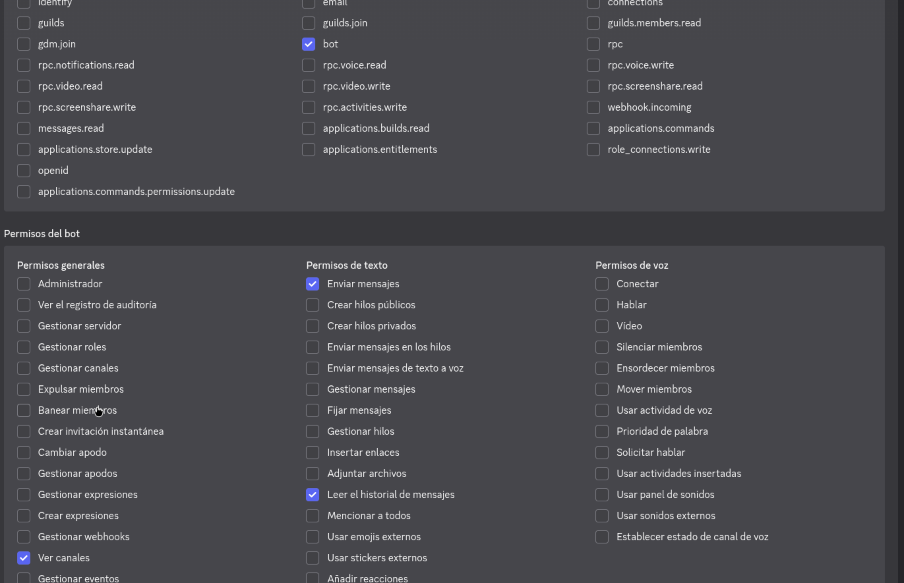

# IssueBot

Discord bot running on Cloudflare Workers that connects Discord channels to GitHub Project Boards in the Inled-Pulsar-OS and InledGroup organizations.

## Overview

IssueBot allows community members and developers to report errors, propose suggestions, and view open issues on GitHub Project Boards directly from Discord by mentioning the bot.

Supported Project Boards:
- Inled-Pulsar-OS: https://github.com/orgs/Inled-Pulsar-OS/projects/1/views/2
- InledGroup: https://github.com/orgs/InledGroup/projects/1/views/1

---

## Commands and Usage

### 1. Adding an Issue to a Board
Mention `@IssueBot` and include:
- Issue type: `error` (or `bug`) or `suggestion` (or `idea`)
- Target organization: `pulsar` (for Inled-Pulsar-OS) or `inled` (for InledGroup)
- Description of the issue

Examples:
```
@IssueBot error pulsar Spotlight icon does not show in dock
@IssueBot suggestion pulsar Add dark mode toggle in control center
@IssueBot error inled Login button unresponsive in customer portal
@IssueBot suggestion inled Improve CLI installer output
```

The bot adds a draft issue to the corresponding GitHub Project Board, automatically tags it with the appropriate Type (Error or Idea), and responds with confirmation and links.

### 2. Viewing Issues from a Board
Mention `@IssueBot` with `view` and the target organization (`pulsar` or `inled`):

Examples:
```
@IssueBot view pulsar
@IssueBot view pulsar error
@IssueBot view inled
```

The bot queries the project items and replies with a numbered list of open issues, links to each on GitHub, and a direct link to the Project Board.

---

## Log Dashboard

IssueBot includes a built-in public activity log dashboard served at `/` and `/logs`:
- Real-time Gateway connection status
- Connected Discord bot identity
- Live event logs (issue creation, views, errors) with organization filtering
- Direct links to both GitHub Project Boards

---

## Configuration and Secrets

Configure the following secrets in Cloudflare Workers using Wrangler:

```bash
# Discord Bot Token
npx wrangler secret put DISCORD_BOT_TOKEN

# GitHub Personal Access Token (requires project and repo scopes)
npx wrangler secret put GITHUB_TOKEN
```



---

## Deployment

1. Install dependencies:
   ```bash
   npm install
   ```

2. Deploy to Cloudflare Workers:
   ```bash
   npm run deploy
   ```

3. Initialize Gateway Connection:
   Visit the deployed worker URL and click "Reconectar Gateway".

---

## License

MIT - InledGroup
